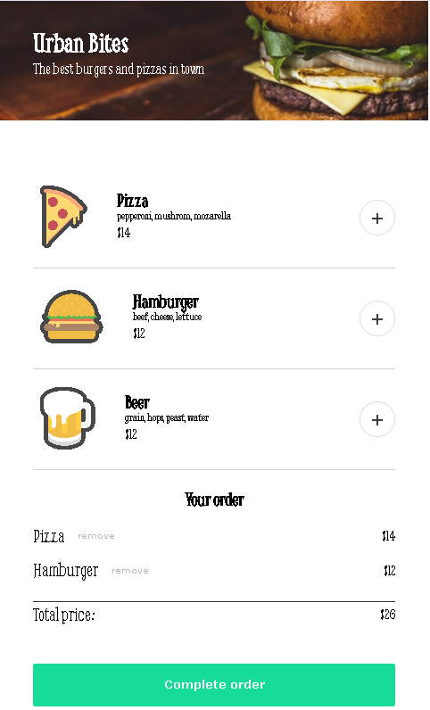

# 🍔 Urban Bites

A restaurant ordering app built with **HTML**, **CSS**, and **JavaScript** as part of the Scrimba Fullstack Developer Path.

## 📷 Preview

<div align="center">
  
</div>

## 🚀 Features

- Dynamically render restaurant menu items.
- Add multiple items to an order.
- Remove individual items from an order.
- Automatically calculate and update the total price.
- Display a checkout modal with payment form validation.
- Cancel checkout without losing the current order.
- Show a personalized confirmation message after submitting an order.
- Start a new order without refreshing the page.

## 🛠️ Technologies

- HTML5
- CSS3
- JavaScript (Vanilla)
- Vite

## 🎯 Learning Goals

This project was created to practice:

- DOM manipulation and dynamic rendering
- Event handling and event delegation
- Array methods (`forEach`, `find`, `filter`)
- Template literals
- Managing application state with JavaScript
- Form handling and input validation
- CSS Flexbox
- Modal interfaces and overlays

## ▶️ Live Demo

[View Live Demo](https://urban-bites-sm.netlify.app/)

## 📂 Installation

Clone the repository:

```bash
git clone https://github.com/sanleomon/restaurant-ordering-app.git
```

Open the project folder:

```bash
cd restaurant-ordering-app
```

Install the dependencies:

```bash
npm install
```

Run the development server:

```bash
npm run dev
```

## 📚 About

This project was built as part of the **Scrimba Fullstack Developer Path**.

The user interface was recreated from a provided Figma design, while the menu rendering, order management, and checkout interactions were implemented using vanilla JavaScript.

The checkout process is a simulation for educational purposes. No real payments are processed, and users should not enter actual payment card information.